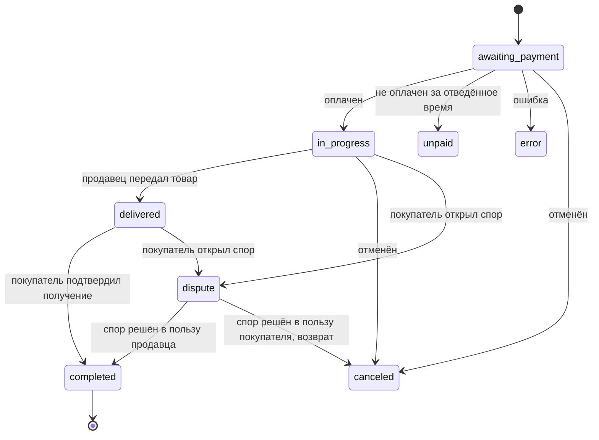

# marketplace-db

Схема PostgreSQL 18 для маркетплейса игровых товаров: пользователи, игры и категории, объявления, заказы, отзывы, чат по заказу и бухгалтерский журнал.

## Запуск

```bash
docker compose up -d
psql -h localhost -U $POSTGRES_USER -d $POSTGRES_DB -f schema.sql
psql -h localhost -U $POSTGRES_USER -d $POSTGRES_DB -f seed.sql
```

## Решения

**UUIDv7 для первичных ключей.** Выбрал `uuidv7()`, потому что такой ключ упорядочен по времени: новые строки дописываются в конец B-tree индекса и не дробят его страницы, как случайный UUIDv4. При этом id нельзя перебрать по порядку, как `serial`, и его можно сгенерировать вне базы. В PostgreSQL 18 функция встроенная.

**Деньги в `NUMERIC(20, 4)`.** Выбрал `numeric`, потому что `float` хранит значения приближённо и ошибается при сложении (`0.1 + 0.2 != 0.3`), а `money` зависит от `lc_monetary` и не хранит валюту. Четыре знака после запятой оставляют запас для комиссий и пересчёта курсов.

**Статусы через `CHECK`, а не `ENUM`.** Выбрал `TEXT ... CHECK (status IN (...))`, потому что такое ограничение можно пересоздать в одной миграции, а значение из `ENUM` удалить нельзя, и новое значение `ALTER TYPE ... ADD VALUE` нельзя использовать в той же транзакции, где его добавили. Слаги проверяются той же логикой через домен `SLUG`.

**Soft delete и `ON DELETE RESTRICT`.** Пользователь и объявление не удаляются физически, а получают `status = 'deleted'`. Выбрал так, потому что на них ссылаются заказы, сообщения и проводки, и эту историю нужно сохранить. `RESTRICT` на таких связях не даёт случайным `DELETE` её стереть. `CASCADE` стоит только там, где дочерние строки не имеют смысла без родителя: роли, картинки объявления, связь игра–категория, отзыв и сообщения заказа.

**Составной внешний ключ `listings (game_id, category_id) → game_categories`.** Выбрал его вместо двух отдельных ключей на `games` и `categories`, потому что так база сама проверяет, что у этой игры есть эта категория. С двумя ключами можно было бы создать объявление «Dota 2 / золото», даже если у Dota 2 такой категории нет.

**Двойная запись (`accounts`, `ledger_transactions`, `ledger_entries`).** Выбрал журнал проводок вместо поля `balance`, потому что каждое движение денег записывается дважды: со счёта (минус) и на счёт (плюс). Сумма `amount` в одной транзакции равна нулю, баланс считается как сумма проводок по счёту, а прошлые записи не меняются. Так видно, откуда взялся каждый рубль. Деньги покупателя до подтверждения лежат на счёте `escrow`, комиссия площадки уходит на `fee`. Пополнение баланса — транзакция без заказа: деньги приходят со счёта `external`, который изображает внешний мир (платёжного провайдера), поэтому его баланс отрицательный и равен сумме всех денег внутри площадки. Нулевую сумму по транзакции схема сама не проверяет: проводки пишутся в одной транзакции БД, и инвариант соблюдает приложение.

**Снимок цены в заказе (`orders.unit_price`).** Выбрал копировать цену в заказ, потому что продавец может поменять цену объявления в любой момент. Заказ должен хранить цену на момент покупки, иначе изменится сумма уже оплаченного заказа и перестанет сходиться с проводками.

## Статусы заказа



| Статус | Значение |
|---|---|
| `awaiting_payment` | ожидает оплаты |
| `in_progress` | оплачен, продавец выполняет заказ |
| `delivered` | продавец отметил заказ доставленным |
| `completed` | покупатель подтвердил получение, заказ выполнен |
| `canceled` | заказ отменён |
| `dispute` | покупатель открыл спор |
| `unpaid` | заказ не был оплачен за отведённое время |
| `error` | ошибка |
